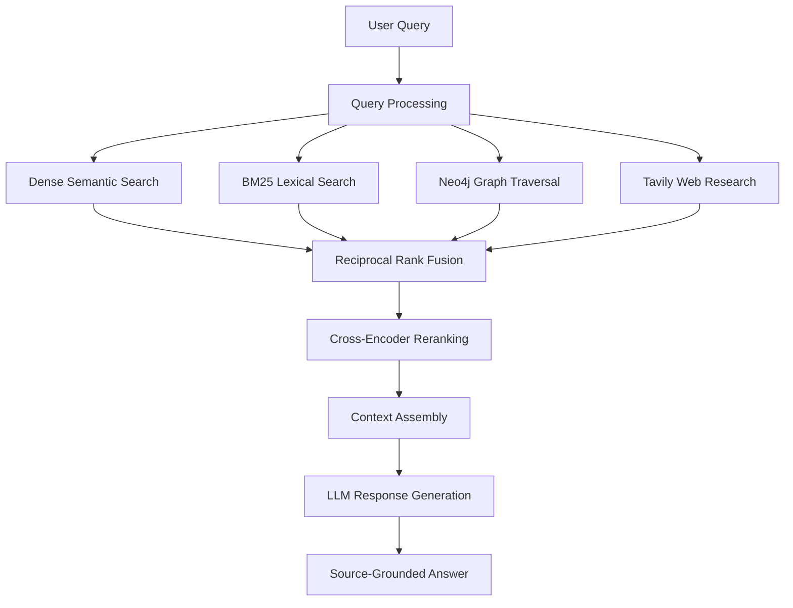
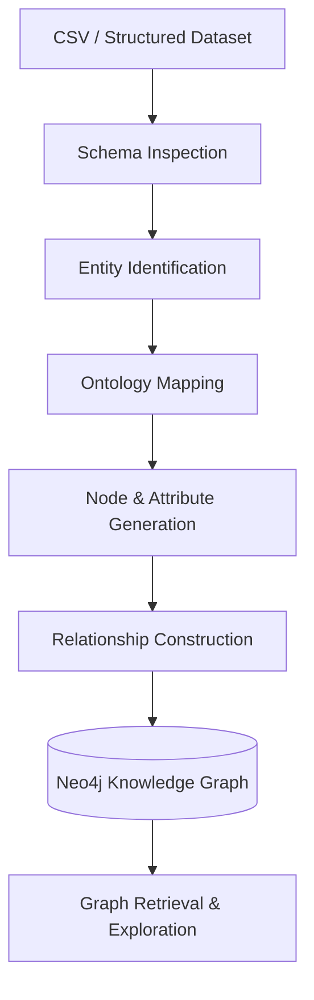
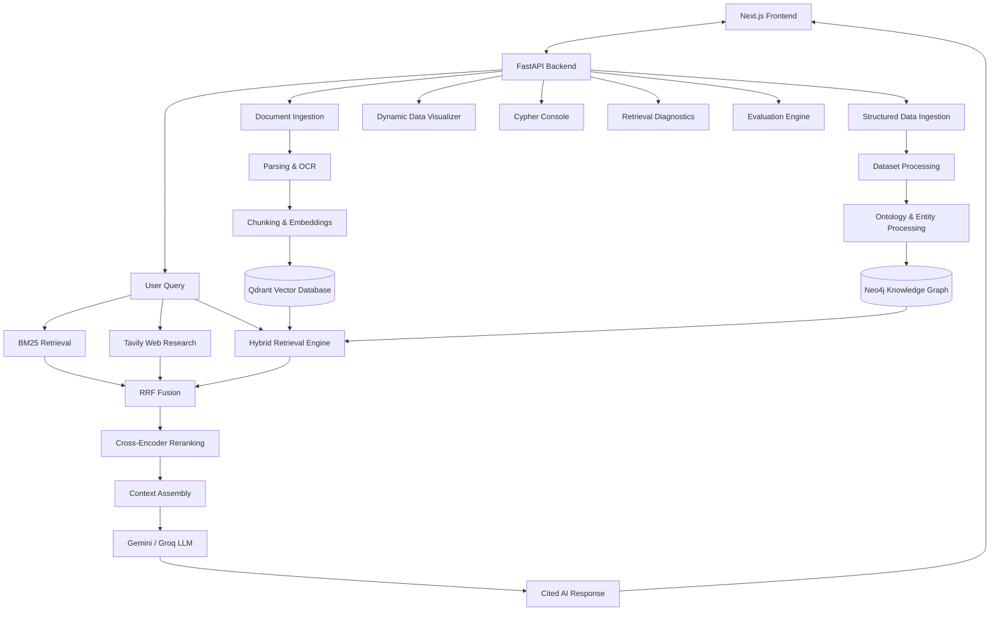

# 🧠 NEXUS AI
### Enterprise Knowledge Retrieval Platform | Hybrid GraphRAG

<p align="center">
  <strong>Connect documents, datasets, and knowledge graphs into one intelligent retrieval ecosystem.</strong>
</p>

<p align="center">
  
  
  
  
  
  
  
  
</p>

---

## 🚀 Overview

**NEXUS AI** is an enterprise-oriented knowledge retrieval platform that combines Hybrid GraphRAG, semantic vector search, lexical retrieval, knowledge graph intelligence, and LLM-powered analytics.

Traditional RAG applications primarily retrieve document chunks using semantic similarity. However, complex questions often require understanding how different entities, records, concepts, and datasets relate to one another.

NexusAI addresses this limitation by combining Qdrant-based vector retrieval with Neo4j-powered knowledge graphs and multiple complementary retrieval channels.

The platform transforms unstructured documents and structured datasets into searchable, connected knowledge that users can explore through conversational AI, graph visualization, and interactive data analysis.

### Core Capabilities

- Multimodal document ingestion and OCR-based extraction.
- 1024-dimensional BGE-M3 embeddings.
- Qdrant vector indexing.
- Neo4j ontology and knowledge graph construction.
- Interactive graph visualization and Cypher console.
- Dense semantic and BM25 lexical retrieval.
- Graph traversal and Tavily web research.
- Reciprocal Rank Fusion (RRF).
- Cross-encoder reranking.
- Source-grounded conversational AI.
- Automated Plotly and Seaborn visualizations.
- LangSmith observability and Ragas/DeepEval evaluation.

> NexusAI moves beyond isolated document retrieval by connecting semantic information, structured relationships, and external knowledge into a unified intelligence platform.

---

# 📚 1. Multimodal Document Ingestion Pipeline

NexusAI incorporates an automated parsing, extraction, and chunking pipeline designed to ingest heterogeneous document formats and structured datasets.

### Supported Document Sources

**Unstructured Documents**
- PDF documents.
- PowerPoint presentations (PPTX).
- Word documents (DOC/DOCX).
- HTML documents.
- TXT documents.

**Structured Datasets**
- CSV files.
- Excel spreadsheets.
- Tabular datasets.

**Image-Based Content**
- Scanned PDFs.
- OCR-supported document content.
- Supported image inputs.

### Document Processing Technologies

| Technology | Purpose |
|---|---|
| Docling | Advanced document parsing and content extraction. |
| PyMuPDF | PDF text extraction and document processing. |
| pypdf | Additional PDF processing. |
| PaddleOCR | Extracting text from scanned and image-based content. |
| pandas | Processing CSV and Excel datasets. |

### Automated Ingestion Workflow

1. **Document Upload:** Accepts supported documents and structured datasets.
2. **Format Detection:** Identifies the document type and selects an appropriate parser.
3. **Content Extraction:** Extracts textual, tabular, and OCR-derived information.
4. **Preprocessing:** Normalizes the extracted information for downstream processing.
5. **Chunking:** Segments content into manageable retrieval units.
6. **Embedding Generation:** Converts document chunks into vector representations.
7. **Indexing:** Stores embeddings and relevant metadata in Qdrant.
8. **Knowledge Graph Processing:** Routes applicable structured information into the ontology and graph construction pipeline.

### Embedding Architecture

NexusAI uses **BGE-M3 with 1024-dimensional embeddings** for semantic document representation.

These embeddings provide the foundation for semantic similarity search, contextual retrieval, and knowledge discovery.

---

# 🔎 2. Hybrid GraphRAG & Multi-Channel Retrieval Engine

The central intelligence layer of NexusAI combines four complementary retrieval channels.

Instead of relying exclusively on vector similarity, the platform brings together semantic search, lexical matching, graph traversal, and external web research.

### Retrieval Channel 1 — Dense Semantic Search

Uses BGE-M3 embeddings and Qdrant to retrieve semantically relevant document chunks.

**Purpose:**
- Understand conceptual similarity.
- Retrieve information despite differences in wording.
- Identify contextually relevant document content.

### Retrieval Channel 2 — BM25 Lexical Matching

Uses keyword-based retrieval to identify documents and passages containing relevant terminology.

**Purpose:**
- Exact keyword matching.
- Technical terminology retrieval.
- Identifier and phrase matching.
- Complementary retrieval to dense semantic search.

### Retrieval Channel 3 — Neo4j Graph Traversal

Uses the knowledge graph to retrieve information through relationships between entities, records, and concepts.

**Purpose:**
- Explore connected information.
- Discover relationships across records.
- Support graph-based contextual retrieval.
- Enable multi-entity information discovery.

### Retrieval Channel 4 — Tavily Live Web Research

Integrates external web research into the retrieval workflow.

**Purpose:**
- Discover external information.
- Retrieve relevant web sources.
- Complement internal knowledge with live research.
- Extend retrieval beyond indexed documents.

### Reciprocal Rank Fusion (RRF)

The four retrieval channels can contribute independently ranked results.

NexusAI combines their rankings using Reciprocal Rank Fusion to produce a unified retrieval result set.

This helps combine different forms of relevance without relying on a single retrieval strategy.

### Cross-Encoder Reranking

After initial retrieval and fusion, cross-encoder reranking refines the candidate results by evaluating query-context relevance more directly.

This creates a second relevance-selection stage before the final context is assembled for LLM generation.

### Retrieval Architecture



---

# 🕸️ 3. Neo4j Knowledge Graph & Ontology Engineering

NexusAI incorporates Neo4j as its graph database to transform structured information into connected knowledge representations.

Instead of treating each dataset record as an isolated row, the ontology pipeline maps records into graph entities, attributes, and relationships.

### Ontology Construction

The graph construction workflow includes:

- Dataset schema inspection.
- Entity and attribute identification.
- Ontology-based mapping.
- Graph node generation.
- Relationship generation.
- Structured record representation.
- Graph persistence in Neo4j.

### Graph Construction Pipeline



### Interactive Knowledge Graph Visualization

NexusAI includes a force-directed graph visualization canvas for exploring connected information.

Capabilities include:

- Interactive node exploration.
- Relationship visualization.
- Connected entity discovery.
- Graph structure inspection.
- Attribute and relationship exploration.
- Visual navigation of knowledge networks.

This provides a graphical representation of information that would otherwise require navigating multiple datasets or database queries.

### Embedded Cypher Console

An integrated Cypher query console allows users to interact directly with the Neo4j knowledge graph.

It supports:

- Graph querying.
- Node and relationship inspection.
- Entity exploration.
- Query-driven knowledge discovery.
- Inspection of graph structures.

The console bridges visual knowledge exploration with direct graph database interaction.

---

# 💬 4. Interactive AI Chat & Source-Grounded Conversations

NexusAI provides an interactive conversational interface for querying documents, structured datasets, and connected knowledge.

### Conversational Capabilities

- Natural-language question answering.
- Multi-document information retrieval.
- Context-aware responses.
- Hybrid GraphRAG retrieval.
- Graph-enhanced contextual reasoning.
- Gemini and Groq API integration.
- Source-grounded answer generation.

### Source-Grounded Citations

NexusAI integrates retrieved source information into its response-generation workflow.

Rather than relying exclusively on the LLM's internal knowledge, the system uses retrieved documents and supporting context to generate traceable answers.

This allows users to inspect the information supporting an answer and makes document-based research more transparent.

---

# 📊 5. Interactive Chat & Dynamic Data Visualizer

NexusAI extends conversational retrieval into structured data exploration.

The Dynamic Data Visualizer allows users to upload tabular datasets and request analytical visualizations using natural language.

### Data Processing

- CSV ingestion.
- Excel spreadsheet processing.
- Tabular data inspection.
- Column and feature analysis.
- Dataset-aware contextual processing.

### AI-Assisted Visualization Synthesis

Users can request visualizations through conversational prompts rather than manually constructing every chart.

The visualization workflow combines LLM-assisted chart synthesis with Python visualization libraries.

### Visualization Technologies

**Plotly**
- Interactive charts.
- Dynamic data visualization.
- Exploratory visual analytics.

**Seaborn**
- Statistical visualizations.
- Correlation heatmaps.
- Distribution and relationship plots.

### Capabilities

- Natural-language visualization requests.
- Dataset-aware chart generation.
- Statistical visualization synthesis.
- Visual exploration of uploaded data.
- Conversational interpretation of structured information.

This connects document intelligence and data analytics within the same knowledge workspace.

---

# 🌐 6. Web Search & External Knowledge Integration

NexusAI integrates Tavily to introduce live external information into its retrieval pipeline.

### Features

- Live web research.
- External information discovery.
- Source retrieval.
- Research-assisted question answering.
- Integration with internal document retrieval.
- Multi-source contextual information assembly.

External web research complements Qdrant semantic retrieval, BM25 lexical search, and Neo4j graph traversal.

This allows NexusAI to combine internal knowledge with external information when supported by the retrieval workflow.

---

# 🔬 7. Retrieval Diagnostics & Hybrid Search Inspector

NexusAI includes a multi-channel retrieval inspection layer that exposes the different stages of information retrieval.

Instead of treating retrieval as a black box, the platform provides visibility into the information returned by individual retrieval strategies.

### Retrieval Diagnostics

| Retrieval Component | What It Inspects |
|---|---|
| Dense Semantic Search | Embedding-based document similarity results. |
| BM25 Lexical Matching | Keyword-based retrieval results. |
| Graph Traversal | Neo4j-connected entities and relationships. |
| Tavily Research | External web research results. |
| RRF | Combined ranking from multiple retrieval channels. |
| Cross-Encoder | Refined relevance ranking of candidate results. |

### Why Retrieval Diagnostics Matter

A generated answer depends heavily on the information supplied to the LLM.

The retrieval inspector helps examine whether the system is finding the right documents, connecting relevant graph entities, incorporating appropriate external information, and ranking useful context.

It also provides a foundation for debugging retrieval behavior and improving search quality.

---

# 📈 8. RAG Observability & Evaluation Engine

NexusAI incorporates an empirical evaluation and benchmarking framework to assess retrieval quality and answer grounding.

### Evaluation Metrics

**Context Precision**

Measures whether the retrieved information is relevant to the query, helping identify irrelevant context.

**Context Recall**

Measures whether the retrieval pipeline captures the relevant information required to answer the query.

**Faithfulness**

Evaluates whether the generated response is supported by the retrieved evidence rather than introducing unsupported claims.

**Hallucination Abstention**

Evaluates the system's ability to avoid making unsupported claims when sufficient evidence is unavailable.

### Evaluation Technologies

- Ragas.
- DeepEval.
- LangSmith.

### LangSmith Observability

LangSmith provides end-to-end visibility into the LLM and retrieval workflows.

Tracked information includes:

- End-to-end execution traces.
- LLM request latency.
- Token usage and telemetry.
- Retrieval and generation execution.
- Evaluation workflow inspection.

### Benchmarking Result

The configured retrieval benchmarking framework has reported **100% context recall** on its evaluated benchmark.

This result reflects the tested evaluation dataset and configuration, not a guarantee of perfect recall across arbitrary queries or datasets.

---

# 🏗️ 9. Complete System Architecture



---

# 🛠️ 10. Complete Technology Stack

| Category | Technologies |
|---|---|
| Frontend | Next.js, TypeScript |
| UI Framework | Tailwind CSS, shadcn/ui |
| Backend | Python, FastAPI |
| RAG Framework | LangChain |
| Vector Database | Qdrant |
| Knowledge Graph | Neo4j |
| Graph Query Language | Cypher |
| Graph Analytics | Neo4j Graph Data Science |
| LLM Providers | Google Gemini, Groq API, OpenLM |
| Embeddings | BGE-M3, all-MiniLM-L6-v2 |
| Embedding Framework | Sentence Transformers, Hugging Face |
| Document Processing | Docling, PyMuPDF, pypdf |
| OCR | PaddleOCR |
| Data Processing | pandas |
| External Research | Tavily |
| Visualization | Plotly, Seaborn |
| Observability | LangSmith |
| Evaluation | Ragas, DeepEval |
| Infrastructure | Docker |

---

# ⚙️ 11. Getting Started

### Prerequisites

- Python 3.11+
- Node.js 20+
- npm
- Docker and Docker Compose
- Qdrant instance
- Neo4j instance
- Gemini or Groq API credentials
- Tavily API credentials for web research

### Clone Repository

```bash
git clone https://github.com/adrika-mandal-tech/NexusAI.git

cd NexusAI
```

### Environment Configuration

Create the required environment files using the supplied `.env.example` templates.

Example configuration:

```env
# LLM Providers
GEMINI_API_KEY=
GROQ_API_KEY=
OPENLM_API_KEY=

# Vector Database
QDRANT_URL=
QDRANT_API_KEY=

# Neo4j
NEO4J_URI=
NEO4J_USERNAME=
NEO4J_PASSWORD=
NEO4J_DATABASE=

# External Research
TAVILY_API_KEY=

# Observability
LANGSMITH_TRACING=
LANGSMITH_API_KEY=
LANGSMITH_PROJECT=
```

Use the actual variable names expected by the application configuration.

### Start Infrastructure

```bash
docker compose up -d
```

### Start Backend

Navigate to the backend directory:

```bash
cd apps/backend
```

Install the dependencies using the configured dependency manager and run the FastAPI application through its actual ASGI entry point.

### Start Frontend

```bash
cd apps/frontend

npm install
npm run dev
```

Open the local development URL provided by Next.js.

---

# 🔐 12. Security & Reliability

- Environment-based API credential management.
- Protected database credentials.
- Validation of uploaded documents and datasets.
- Safeguards for Cypher query execution.
- Controlled external tool integration.
- Retrieval-grounded response generation.
- Evaluation-driven quality monitoring.

---

# 🗺️ 13. Future Roadmap

- [ ] Advanced multi-hop graph reasoning.
- [ ] Improved ontology generation.
- [ ] Advanced graph-aware query expansion.
- [ ] More sophisticated hybrid retrieval optimization.
- [ ] Expanded multimodal document understanding.
- [ ] Advanced reranking strategies.
- [ ] Improved retrieval benchmarking.
- [ ] Production deployment and scalability improvements.

---

# 🎯 Project Vision

NexusAI explores a more connected approach to enterprise knowledge retrieval.

By combining semantic search, lexical matching, Knowledge Graphs, external web research, and LLM-powered reasoning, NexusAI transforms disconnected documents and datasets into a unified, searchable, and explorable knowledge ecosystem.

**Search semantically. Connect intelligently. Retrieve with context.**

---

## 👩‍💻 Author

**Adrika Mandal**

B.Tech – Computer Science Engineering  
Specialization: Data Science & Artificial Intelligence

- GitHub: [@adrika-mandal-tech](https://github.com/adrika-mandal-tech)
- LinkedIn: [adrika-mandal](https://www.linkedin.com/in/adrika-mandal/)

---

⭐ If you find NexusAI interesting, consider giving the repository a star!
