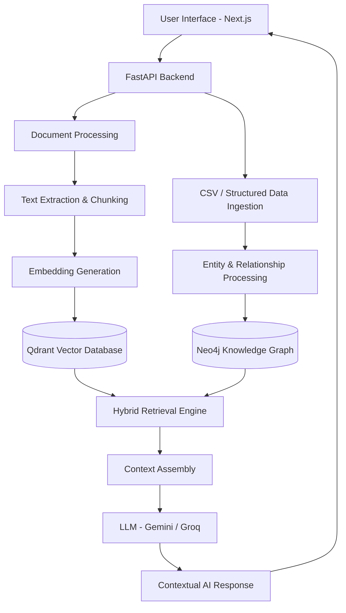

# 🧠 NexusAI
### Intelligent Knowledge Discovery Through Hybrid RAG & Knowledge Graphs

<p align="center">
  <strong>Transform documents and structured data into connected, searchable intelligence.</strong>
</p>

<p align="center">
  
  
  
  
  
  
</p>

---

## 🚀 Overview

**NexusAI** is an intelligent knowledge discovery platform that combines Retrieval-Augmented Generation (RAG), vector search, and Knowledge Graph technology to make information retrieval more contextual, connected, and explainable.

Traditional document search often struggles to understand relationships between entities, concepts, and information distributed across multiple documents.

NexusAI addresses this limitation through a hybrid retrieval architecture that combines:

- **Vector Search:** Semantic similarity-based document retrieval.
- **Knowledge Graphs:** Entity relationships and connected information using Neo4j.
- **Hybrid Retrieval:** Combining semantic and graph-based retrieval.
- **LLM-powered Generation:** Context-aware responses using language models.
- **Document Intelligence:** Extracting and processing information from uploaded documents and structured datasets.

The objective is simple:

> Move beyond searching documents. Build an intelligent system that understands the information inside them and how that information connects.

## ✨ Core Features

### 1. Intelligent Document Processing
- Upload and process knowledge documents.
- Extract meaningful textual content.
- Parse and prepare documents for retrieval.
- Chunk documents into manageable semantic units.
- Generate vector embeddings for semantic indexing.

### 2. Hybrid RAG Architecture
NexusAI combines two complementary retrieval approaches:

**Semantic Retrieval**
- Embedding-based similarity search.
- Contextual document retrieval.
- Qdrant-powered vector indexing.

**Graph Retrieval**
- Entity and relationship exploration.
- Graph-based contextual retrieval.
- Neo4j-backed knowledge persistence.
- Read-only Cypher querying with safeguards.

**Hybrid Intelligence**

The retrieval pipeline combines relevant vector and graph context to provide more informed responses.

### 3. Knowledge Graph Intelligence
- Convert structured information into connected representations.
- Persist graph entities and relationships in Neo4j.
- Explore relationships between concepts.
- Support graph-based retrieval and analysis.
- Expose graph APIs for knowledge exploration.

### 4. Chat With Your Documents
Interact with uploaded knowledge through natural-language conversations.

Capabilities include:
- Context-aware question answering.
- Semantic document retrieval.
- Knowledge-grounded responses.
- Multi-document information discovery.
- Graph-enhanced contextual understanding.

### 5. LLM Integration
Designed with support for language-model integrations including:
- Google Gemini.
- Groq.

The model layer supports AI-powered response generation and reasoning over retrieved context.

### 6. Structured Data Intelligence
NexusAI also supports graph-oriented processing of structured data, including CSV ingestion and knowledge representation.

---

## 🏗️ System Architecture



### Retrieval Pipeline

1. User submits a natural-language query.
2. The backend processes the query.
3. Semantic retrieval searches relevant vector representations.
4. Graph retrieval explores relevant entities and relationships.
5. Retrieved information is combined into contextual evidence.
6. The LLM generates a response grounded in the available context.
7. The response is returned to the frontend.

---

## 🛠️ Technology Stack

| Layer | Technologies |
|---|---|
| Frontend | Next.js, React |
| Backend | Python, FastAPI |
| LLM Integration | Google Gemini, Groq |
| Vector Database | Qdrant |
| Graph Database | Neo4j |
| Embeddings | BGE-M3 |
| RAG Framework | LangChain |
| Document Processing | Docling, document parsers |
| Background Processing | Celery |
| Infrastructure | Docker, Docker Compose, NGINX |
| Testing | Pytest |
| CI/CD | GitHub Actions |

---

## 📂 Project Structure

```text
NexusAI/
│
├── apps/
│   ├── backend/
│   │   ├── src/
│   │   │   └── nexusai/
│   │   │       ├── api/
│   │   │       ├── auth/
│   │   │       ├── knowledge/
│   │   │       ├── graph/
│   │   │       ├── ingestion/
│   │   │       ├── retrieval/
│   │   │       ├── embeddings/
│   │   │       ├── llm/
│   │   │       ├── parsers/
│   │   │       └── workers/
│   │   └── tests/
│   │
│   └── frontend/
│
├── docs/
├── tests/
├── docker/
├── nginx/
├── .github/
├── docker-compose.yml
├── .env.example
├── .gitignore
└── README.md
```

*The structure above represents the main architectural areas; individual filenames may vary across versions.*

---

## ⚙️ Getting Started

### Prerequisites

- Python 3.11+
- Node.js 20+
- npm
- Docker and Docker Compose
- Qdrant instance
- Neo4j instance
- Gemini or Groq API credentials

### 1. Clone the repository

```bash
git clone https://github.com/adrika-mandal-tech/NexusAI.git

cd NexusAI
```

### 2. Configure environment variables

Create environment files using the supplied `.env.example` templates.

Typical configuration:

```env
# LLM
GEMINI_API_KEY=
GROQ_API_KEY=

# Vector Database
QDRANT_URL=
QDRANT_API_KEY=

# Knowledge Graph
NEO4J_URL=
NEO4J_USERNAME=
NEO4J_PASSWORD=
NEO4J_DATABASE=

# Application
APP_ENV=development
```

Use the actual variable names documented in the backend configuration when setting up your environment.

### 3. Start infrastructure

```bash
docker compose up -d
```

### 4. Start the backend

Navigate to the backend directory and install dependencies using the project's dependency manager.

```bash
cd apps/backend
```

Then run the FastAPI application using its configured ASGI entry point.

### 5. Start the frontend

```bash
cd apps/frontend
npm install
npm run dev
```

Open the frontend at the development URL displayed by Next.js.

---

## 🔐 Security Considerations

- API credentials should remain in environment variables.
- Never commit actual `.env` files or private keys.
- Graph query execution should remain protected by read-only safeguards.
- Uploaded customer datasets should not be exposed publicly.
- Validate and sanitize user-provided inputs.

---

## 🗺️ Roadmap

- [ ] Advanced hybrid retrieval and ranking.
- [ ] Improved graph-aware query expansion.
- [ ] More sophisticated multi-hop graph traversal.
- [ ] Enhanced document citation and source attribution.
- [ ] Expanded document-format support.
- [ ] Retrieval evaluation and observability.
- [ ] Production deployment and scalability improvements.

---

## 🎯 Project Vision

NexusAI aims to bridge the gap between traditional document retrieval and connected knowledge intelligence.

By integrating vector databases, knowledge graphs, and large language models, it explores a more structured approach to building AI systems that can retrieve, connect, and reason over information.

**Built to connect knowledge, not just retrieve text.**

---

## 👩‍💻 Author

**Adrika Mandal**

B.Tech – Computer Science Engineering  
Specialization: Data Science & Artificial Intelligence

- GitHub: [@adrika-mandal-tech](https://github.com/adrika-mandal-tech)
- LinkedIn: [adrika-mandal](https://www.linkedin.com/in/adrika-mandal/)

---

⭐ If you find this project interesting, consider giving the repository a star!
